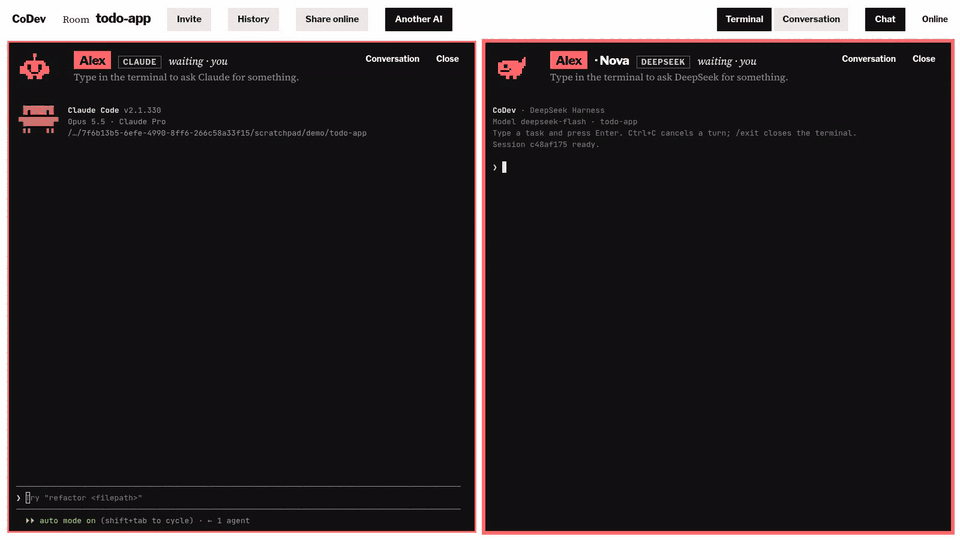

# CoDev

**Code as a team with AI without stepping on each other.**



*Claude Code and DeepSeek get tasks that touch the same files. DeepSeek claims them first; Claude messages it and waits, then builds on top of its changes. Real run, sped up 3×.*

Hardly anyone writes code by hand anymore: everyone gives instructions to their own AI. The trouble starts when two people (and two AIs) work on the same project at once. They change the same files, one AI undoes what the other just did, and you end up with conflicts.

CoDev fixes this with three pieces:

1. **A live split screen.** A desktop app with the whole team's AI terminals side by side: Claude, DeepSeek, a model running on your own computer with Ollama, or ChatGPT. You type in yours as usual. You watch your teammates' terminals live, exactly as they see them. Above each terminal, a small character shows what that AI is doing (working, typing, waiting, asleep...), along with its name, its current task and the files it holds. Anyone can also watch the room from a browser, with the same interface.
2. **Your AI knows what your teammate's AI is doing.** Before every prompt, CoDev adds a summary of the team's work to your AI's context: tasks, claimed files, recent activity and notes.
3. **File locking.** When an AI edits a file, it claims it. If another AI tries to edit that file, CoDev blocks the edit and tells it who is working there and on what. Claude Code and Codex enforce this before the edit; the Harness uses the same claim tools through MCP (so it is advisory there for now). The AIs can also ask each other for things with notes.

<a id="desktop-app-recommended"></a>

## Install

Download the installer for your system from the **[latest release](https://github.com/santigonzalezballbe-arch/CoDev/releases/latest)**:

| System | File | How |
|---|---|---|
| Linux (any distribution) | `CoDev-<version>-x86_64.AppImage` | `chmod +x CoDev-*.AppImage`, then open it. Nothing is installed. |
| Ubuntu, Debian and derivatives | `CoDev-<version>-amd64.deb` | `sudo apt install ./CoDev-*.deb`, then open CoDev from your apps menu. |
| Windows | `CoDev-Setup-<version>.exe` | Run it and follow the steps. |
| macOS (Apple silicon) | `CoDev-<version>-arm64.dmg` | Open it and drag CoDev to Applications. |

The app opens the AI you choose, but does not include any of them. Install the ones you will use:

| AI | What it needs |
|---|---|
| **Claude** | [Claude Code](https://docs.anthropic.com/en/docs/claude-code) and a Claude account. If it is not installed, CoDev installs it the first time you open a Claude terminal (with Anthropic's native installer; on Windows also Git for Windows, through winget), and Claude Code asks you to sign in. |
| **DeepSeek** | Node.js 20+, the [DeepSeek Harness](https://deepseek-harness.github.io/deepseek-harness/en/guide/quickstart) (`npm i -g @deepseek-ai/dsh`) and a [DeepSeek API key](https://platform.deepseek.com/api_keys). No Claude Code needed. |
| **Local** | Node.js 20+, the DeepSeek Harness and [Ollama](https://ollama.com) running, with at least one model pulled (`ollama pull qwen2.5-coder:7b`). No Claude Code needed. |
| **ChatGPT** (experimental) | [OpenAI Codex CLI](https://github.com/openai/codex): `npm i -g @openai/codex`, then `codex login`. |

**The installers are not signed.** CoDev is free and open source and has no paid signing certificates, so the first time:
- **Windows** shows "Windows protected your PC": click **More info**, then **Run anyway**.
- **macOS** says it cannot check the app: in Applications, right-click CoDev, choose **Open**, then **Open** again. Only once.

The app itself does not need Node.js (it brings its own runtime); the DeepSeek Harness does, because `dsh` is a Node program. The tool for sharing online is downloaded the first time you use it.

### From source

```bash
git clone https://github.com/santigonzalezballbe-arch/CoDev.git
cd CoDev
npm install          # Electron, xterm.js and the PTY (also downloads the Electron binary)
npm run app
```

## Using the app

1. Write **your name**, choose **your AI** and **where you will work**: a **GitHub repository** (it suggests your repositories if you are signed in with `gh`, or paste any URL) or a **local folder**. If you choose **DeepSeek**, pick `deepseek-flash` (fast, 1M context) or `deepseek-v4-pro` and paste its API key: it is encrypted with your system keychain and the interface never shows it again. If you choose **Local**, pick one of the models installed in Ollama; CoDev warns you when they can be slow.
2. Choose **Create a room** if your computer will be the server, and who can join: **Same network** or **Anyone with the invite** (over the internet, see below). Or choose **Join a room** and paste the invite your teammate sent you: it fills in the server, the room and the key. If the room already has a repository, the app detects it and clones it for you into `~/CoDev/<name>`.
3. Enter. The app sets up the MCP server in the project (and the Claude Code/Codex hooks when you use those engines) and opens your AI in your terminal.

What you will find:
- **Your terminal** (left): the AI you chose, running in a real terminal. Claude runs Claude Code; DeepSeek and local models run the **DeepSeek Harness** (a chat in the terminal, no Claude Code); ChatGPT runs OpenAI's Codex CLI. You type in it as usual. `Ctrl+Shift+C` copies the selection.
- **Your teammates' terminals** (right): live, read-only replicas with the same columns and rows as the original, scaled to fill their window. Each header shows whose terminal it is, which AI it runs and what it is doing.
- **Two views**, for all windows from the top bar or one window at a time from its header:
  - **Terminal**: the real AI session. Text grows with the window (13 to 22 px), so big screens stay readable.
  - **Conversation**: each AI as a chat. Prompts, the AI's replies with formatting, what it did (with diffs), and a clear call when it needs you (*Answer in the terminal*). With Claude Code and Codex you can write a prompt here; the Harness terminal is already a chat, so there you type in the **Terminal** view and this window follows along. Replies come from the transcript Claude Code keeps for each session (`transcript_path`) or from the Harness bridge.
- **The character** above each terminal shows its state: *working*, *typing*, *waiting*, *asleep*, *stopped by CoDev* or *offline*. Each AI has its own character: Claude's robot, DeepSeek's whale, the local model's llama, and ChatGPT's robot with a visor. Typing counts only real keys and pastes (not the focus and mouse reports a terminal sends by itself), and is shared without ever sending what you type. *Working* needs sustained output, like the AI's spinner, not a single redraw.
- **Another AI**: opens another terminal of your own, with the same AI or a different one. You give it a name (a suggestion like *Nova*, or what it is on: *frontend*, *tests*...) and it shows as "Alex · tests" in your colour. Each terminal is its own agent with its own AI, its own session and its own claimed files: for example, Claude on the interface and DeepSeek on the tests.
- **Invite**: copies a one-line invite link with the server, the room and the room key. Opened in a browser, the page offers to open the CoDev app (through a `codev://` link) and the app jumps straight into the join screen of that room. Without the app, the same page lets you watch the room in the browser. Pasting the link into the app's join screen also fills in everything.
- **Share online / Stop sharing online**: the room's host can open or close the internet link at any time.
- **Chat**: a side panel with the room's conversation: people, notes from the AIs and CoDev's alerts. Write to everyone or to one person (also people watching from a browser); their AI reads the messages sent to them at its next prompt. It shows unread messages, keeps the conversation in the history file, and sends a desktop notification when CoDev is in the background.
- **Colours**: the interface is black and white; only the AI terminals (which keep their own colours) and people have colour. The server gives everyone in a room a different colour, the same on every screen: their name, their character, and their messages in the chat and the history.
- **Alerts**: when CoDev stops an AI because it was about to touch someone else's file, a banner appears.
- **History**: every prompt (in full), change (with its diff), command, note and conflict in the room, grouped by day, with search and filters by person and kind. The app saves it to `.codev/history.jsonl` in the project folder: one JSON object per line, kept across restarts, git-ignored, easy to grep or import. **Show the file** opens its folder. A browser shows the room's recent activity only.

If port 4321 is taken, the app uses the next free one.

### The AIs

All four get CoDev's live terminal and character, the `codev/` project log, the MCP tools and the chat. What changes is the engine that runs them (`desktop/agents.js`):

- **Claude** runs Claude Code as usual, with the project's hooks, so CoDev's file locking is automatic.
- **DeepSeek** runs the **DeepSeek Harness** (`dsh`) over its ACP stdio profile. No Claude Code. It uses `deepseek-flash` by default (1M context) or `deepseek-v4-pro` for harder work, and CoDev drives the session: prompts, streaming replies, tool calls and permission answers. The API key is encrypted with the operating system's keychain (`safeStorage`) and passed to the Harness in the environment; the screen never shows it again. If the system has no keychain, CoDev refuses to save it instead of writing it in plain text. On a Linux desktop with more than one keyring (KDE, for example), if the screen says there is no keychain, start CoDev with the other one: `CODEV_PASSWORD_STORE=gnome-libsecret` or `CODEV_PASSWORD_STORE=kwallet6`. Use the same keyring every time: a key saved with one cannot be read by the other.
- **Local** runs the same Harness against Ollama's OpenAI-compatible endpoint (`http://localhost:11434/v1`). The model list comes from Ollama itself. A model on a CPU can take minutes per answer: CoDev warns you and suggests a small one. With a GPU, or a 7B model, it is usable.
- **ChatGPT** (experimental) runs in **OpenAI's Codex CLI**. CoDev passes the MCP server and its instructions on the command line (`-c`), so your Codex configuration is not touched, and installs Claude-compatible hooks in `.codex/hooks.json` when the terminal opens. Codex's edits arrive as patches, and CoDev locks and logs them like Claude's edits. **Codex asks you once to trust the folder before it runs the hooks**, so until you accept, the terminal works but file locking does not. This path is newer than the others: treat it as experimental.

A room can mix them freely. The header of each terminal shows which AI it runs, the character matches, and the conversation view says "*DeepSeek* is working" instead of always naming Claude.

**Harness and file locking:** the Harness has no Claude Code hooks, so CoDev cannot intercept an edit before it happens. It mounts CoDev's MCP server instead, and the Harness AI is instructed to call `codev_claim_files` before changing a file and `codev_release_files` after; the MCP server still reports conflicts and the `codev/` log is kept. Automatic denial on a claimed file is only enforced for Claude Code and Codex today. This is the main difference to keep in mind when mixing a Harness terminal with a Claude one.

### Teammates on another network

Choose **Anyone with the invite** when you create the room (or press **Share online** later). The app opens a [Cloudflare quick tunnel](https://developers.cloudflare.com/cloudflare-one/connections/connect-networks/do-more-with-tunnels/trycloudflare/), waits until the public address answers, and the **Invite** button then copies a link like `https://random-words.trycloudflare.com/?room=…&key=…`. No account, no router setup and no server costs are needed. The address changes every time, and your computer has to stay on.

The tunnel runs on [`cloudflared`](https://github.com/cloudflare/cloudflared) (Apache 2.0). If you already have it installed, CoDev uses yours. Otherwise, the first time you share online the app downloads it from Cloudflare's GitHub releases into its own data folder (about 40 MB, a few seconds). The version and the SHA-256 of each file are pinned in `desktop/cloudflared.js`, and a download that does not match is thrown away.

**Every room the app creates is locked with a random key.** Without it, the server answers nothing: no state, no activity, no terminals. The key travels inside the invite, so send the invite only to your teammates. The terminals can show private code or secrets, and anyone with the invite can watch them.

Room events and terminals travel over a single WebSocket, which passes through the tunnel as it is.

### From a browser

The invite link works in any browser, with the same black-and-white interface: every terminal in the room, live, with the characters and the notes. When the CoDev app is installed, the page offers to open it (`codev://join?...`); running from source on Linux, the app registers that link type the first time it starts, with a small `~/.local/share/applications/codev-dev.desktop` file. **Get the CoDev app** links here.

A browser cannot run programs on its own computer, so **Open my Claude Code** asks the room's host for a terminal on *their* computer:

1. The host sees who is asking and clicks **Allow** or **Deny** (unanswered requests are denied after 2 minutes).
2. If the project is a git repository, the guest gets their own copy as a git worktree, on branch `codev/<name>` (in `~/CoDev/worktrees/`), so they never edit the host's files directly. Otherwise they work in the same folder, and the request says so.
3. Claude Code starts there with an empty, temporary config folder: the guest signs in with **their own Claude account**. The folder is deleted when the terminal closes, so their sign-in never stays on the host's computer.
4. The host sees the guest's terminal marked *running on this computer* and can **Stop** it at any time. It also stops when the guest leaves.

Only allow people you trust: the guest's Claude Code can run commands on the host's computer, like a shared terminal.

## Architecture

```
 Ana's app                              CoDev server                       Marc's app
┌────────────────────────┐        ┌─────────────────────────┐        ┌────────────────────────┐
│ xterm.js ⇄ PTY: AI     │──WS───▶│ terminal relay          │◀──WS───│ xterm.js ⇄ PTY: AI     │
│   ├─ codev hook ───────┼─HTTP──▶│ rooms: members, tasks,  │◀─HTTP──┼── codev hook           │
│   └─ codev mcp         │        │ claimed files, repo,    │        │   codev mcp            │
│ headers ◀───── WS ─────│◀───────│ activity, notes         │───────▶│ ───── WS ────▶ headers │
└────────────────────────┘        └─────────────────────────┘        └────────────────────────┘
```

- `desktop/`: the Electron app. `main.js` runs the PTYs, the Harness bridge and Codex, keeps the AI keys in the system keychain, clones repositories, hosts the server and opens the tunnel. `agents.js` says which engine each AI uses (Claude Code for Claude, the DeepSeek Harness for DeepSeek and local models, Codex for ChatGPT). `cloudflared.js` finds or downloads cloudflared. `history.js` writes the local history file. `renderer.js` holds the xterm.js terminals, the relay, the headers, the four characters and the history panel.
- `server/`: REST API, WebSocket (`terminals.js`: terminals, the AI each one runs, and room events) and the browser view, which is the desktop UI itself served from `desktop/`.
- `cli/`: the `codev` command. It includes the Claude Code/Codex hooks, the MCP server, `harness.js` (the ACP terminal for the DeepSeek Harness), `init`, `watch` and `status`.
- `test/`: end-to-end tests with the real server, hooks, MCP server and terminal relay, plus how each AI is started.

**How a terminal is relayed:** the app sends the PTY output once xterm.js has processed it. Every 3 seconds it also sends a snapshot of the screen (`@xterm/addon-serialize`). The server keeps the latest snapshot and the chunks after it, so whoever connects late sees the exact screen. Only the owner can publish to their own terminal.

## Without the app (CLI only)

The hooks and the MCP server work on their own, with no window: file locking and team context between AIs. To see each other's terminals, use the desktop app.

### 1. Start the server (once for the whole team)

```bash
node cli/codev.js server            # http://localhost:4321
```

If your teammate is on another network, expose the port with a tunnel (for example `cloudflared tunnel --url http://localhost:4321`) and use that URL as `--server`.

### 2. Connect the project (each person, in their own copy of the repository)

```bash
npm link                            # optional: makes the `codev` command available everywhere
cd your-project
codev init --room my-project --name Alex --server http://localhost:4321
```

If the server was started with `--key`, pass the same `--key` to `codev init`.

This:
- creates `.codev.json` (room, name and server) and adds it and `.codev/` (the history) to `.gitignore`;
- adds the hooks to `.claude/settings.local.json` without touching the ones you already have;
- registers the `codev` MCP server in Claude Code (local scope).

The first time, Claude Code asks whether you trust the folder, because it has hooks. Say yes.

Codex works from the app: when you open a **ChatGPT** terminal, CoDev installs the same hooks in `.codex/hooks.json` (also without touching the ones you already have) and passes it the MCP server at launch. Codex also asks you once to trust the folder.

### 3. Work

Use Claude Code as usual. `codev status` shows what your teammates are doing.

## The `codev/` folder: a project log written by the AIs

CoDev tells every AI in the room to keep a log **inside the repository**, so the whole team (and anyone who clones the project later) can read what was done and why:

- After any task that changes files, the AI appends an entry to `codev/history/<name>.md`: when, what was asked, what changed and why, and what is left to do. It commits it with the rest of its changes.
- Each person's AI writes only its own file, so the logs are never locked and never conflict when you merge.
- Before starting a task, the AI is told to read its teammates' logs in `codev/history/`.
- With Claude Code and Codex, if a turn changed files but the AI did not write its entry, CoDev's `Stop` hook asks it to write it before finishing (once per turn, so it can never get stuck). The Harness has no hooks: its rules tell it to keep the log.
- `codev init` and the app create `codev/README.md` explaining the folder.

This is the shared, human-readable log; `.codev/history.jsonl` (with a dot, git-ignored) is each person's complete local record.

## What each hook does

The same handler runs for Claude Code and for Codex. DeepSeek and Local run the DeepSeek Harness, which does not use these hooks: they get CoDev's rules through their profile and CoDev's MCP server through the ACP session.

| Hook | What CoDev does |
|---|---|
| `SessionStart` / `UserPromptSubmit` | Publishes your prompt as the "current task" and gives the AI CoDev's rules (the `codev/` log) and the team summary |
| `PreToolUse` (Claude's Edit/Write/MultiEdit/NotebookEdit, or a Codex patch) | Claims the files (except anything in `codev/`). If one belongs to someone else, **denies** the edit and explains why |
| `PostToolUse` | Publishes the action (with a diff if it is an edit) |
| `Notification` | Publishes the AI's requests for attention (a permission, a question): the character shows *needs you* |
| `Stop` | If files changed but the `codev/` log was not written, asks the AI to write it first; then marks it as "waiting" |
| `SessionEnd` | Releases your files |

If the server does not answer, the hooks do nothing: CoDev never blocks your work because of its own failure. Claims expire after 20 minutes without activity.

## MCP tools for the AI

- `codev_team_status`: what your teammates are doing.
- `codev_claim_files` / `codev_release_files`: reserve or release files ahead of time.
- `codev_send_note`: send a message to the chat, to one teammate or everyone (they see it on screen and their AI receives it).
- `codev_read_chat`: read the room's chat: messages between people and AIs, and CoDev's alerts.
- `codev_search_history`: search every prompt, AI reply, change, command and message, by words, person, kind and time ("who changed src/auth.js and why?"). It combines what the server keeps with the project's `.codev/history.jsonl`.
- `codev_set_intent`: announce the current plan.

## Other AIs (Cursor, Copilot, Gemini CLI...)

Without hooks, edits cannot be blocked, but `codev watch` publishes every disk change to the room and flags a conflict if you touch a file claimed by someone else. If the tool supports MCP, you can register `node cli/codev.js mcp` in it.

## Building the installers

```bash
npm run dist:linux   # AppImage and .deb, in dist/
npm run dist         # the installers for the system you are on
```

Windows and macOS installers have to be built on those systems. GitHub does it for you: pushing a tag like `v0.4.0` runs [`.github/workflows/release.yml`](.github/workflows/release.yml), which builds the three systems' installers and publishes them as a release.

How the packaged app runs the CLI: there is no separate Node.js, so the app copies the CLI (and the small ACP SDK used by the Harness bridge) to its data folder (`runtime/<version>/`) and the hooks, the MCP server and the bridge run it with the app's own binary as Node (`ELECTRON_RUN_AS_NODE=1`). An AppImage is run through its own file, which does not move between launches. Invite links (`codev://`) are registered by the installer (Windows, macOS, `.deb`) or by the app itself (AppImage, and from source on Linux).

## Tests

```bash
npm test
```

## Current limitations (MVP)

- State lives in memory: restarting the server loses it.
- Teammates' terminals are read-only (you cannot type in someone else's terminal yet).
- A guest terminal runs on the host's computer: it is as powerful as a shared terminal there, and it only exists while the host's app is open.
- If a terminal shrinks while an AI is working (for example when a new teammate joins), drawing artifacts may remain until the next redraw.
- DeepSeek and local models need the DeepSeek Harness installed (`npm i -g @deepseek-ai/dsh`), but not Claude Code. A local model on a machine without a GPU can be too slow to be practical: CoDev warns you, but it cannot make it faster.
- **Harness file locking is advisory:** it uses the MCP claim tools and the rules, not a pre-edit hook, so a Harness AI can still edit a claimed file if it ignores the claim. Automatic denial works with Claude Code and Codex. A DSH plugin could close this gap later.
- The Harness terminal is a chat (text, tool lines, prompts), not a full TUI like its web app. Long replies are printed as they arrive, without rich rendering.
- **ChatGPT is experimental.** Codex must trust the folder before it runs CoDev's hooks; until then its edits are not locked. Testing it with a real OpenAI account is still pending.
- Access control is one key per room, shared through the invite: there are no user accounts, and anyone holding the invite can watch. Rooms started with `codev server` without `--key` are open to anyone who can reach them.
- Locks are per file, not per function or line.
- `Bash` commands that change files (`sed`, `mv`...) are not blocked, only shown.

## Ideas for next versions

- Persistence and user accounts (per-person access, revoking an invite).
- Git integration: see each person's branch and warn about conflicts before merging.
- Locking per symbol or function instead of per file.
- Let an owner hand control of their terminal to a teammate.
- Connectors for more agents through hooks (Cursor, Gemini CLI...).
- Making the ChatGPT/Codex path as tested as the Claude one.
- A DSH plugin that enforces CoDev's file claims before an edit, so Harness agents get the same automatic locking as Claude Code.

## License

[MIT](LICENSE)
